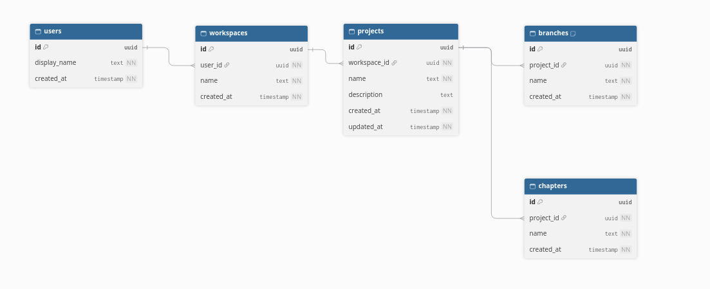

# Schema Design - Local

We have five tables - **users**, **workspaces**, **projects**, **branches**, and **chapters**.

The simplest path is like this - User installs the application, create workspaces and begins.
A **workspace** can have multiple **projects** and a project can have multiple **chapters**. That's the hierarchy. 
(Further, they should be able to toggle cloud backup, create a cloud profile, connect it to their device, and do the backup. Not a concern as of now)

## See Also
[Data Ownership Boundary](../data-ownership-boundary.md)